# 👋 Hi, I’m Xiao

**Author & Maintainer of [XRobot](https://github.com/xrobot-org/XRobot)**  
_Open-source | Robotics | Embedded Systems_

---

## XRobot

> Next-generation modular embedded framework for robotics.  
> Powered by [LibXR](https://github.com/Jiu-xiao/libxr).

---

